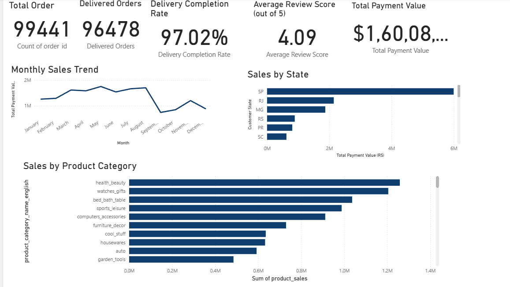
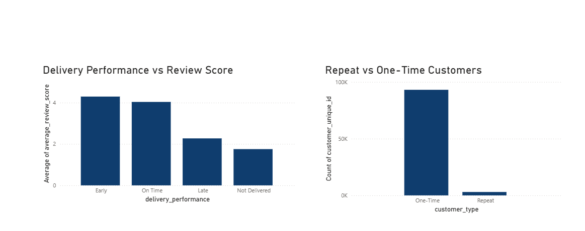

# Olist E-Commerce Business Analytics

## Project Overview

This project focuses on analyzing the Olist Brazilian e-commerce dataset to transform raw transactional data into meaningful business insights.

The analysis will cover sales performance, customer behavior, product performance, logistics, payments, and customer satisfaction.

## Project Objective

To analyze the Olist e-commerce ecosystem and transform raw transactional data into actionable business insights related to sales, customers, products, logistics, payments, and customer satisfaction.

## Key Areas of Analysis

- Sales Performance
- Customer Analytics
- Product Analytics
- Logistics & Delivery
- Customer Satisfaction
- Payment Analysis
- Business Intelligence Dashboard

## Technology Stack

- Python
- Pandas
- NumPy
- Matplotlib
- Seaborn
- Plotly
- SQL
- Power BI
- Jupyter Notebook
- Git & GitHub

## Project Structure

```text
Olist-Ecommerce-Business-Analytics/
│
├── Data/
│   ├── Raw/
│   └── Processed/
│
├── Notebooks/
├── SQL/
├── PowerBI/
├── Reports/
├── Images/
├── README.md
├── requirements.txt
└── .gitignore






